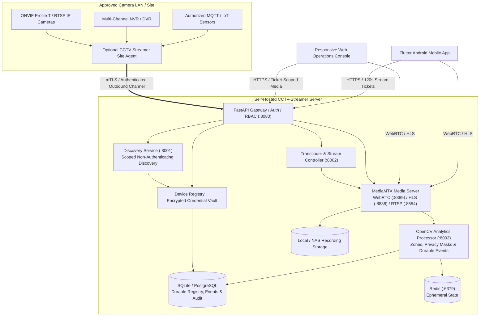

# CCTV-Streamer

[](LICENSE)
[](pyproject.toml)
[](media/mediamtx/mediamtx.yml)
[](services/processor/analytics_engine.py)
[](mobile/flutter_app/README.md)

**CCTV-Streamer** is a self-hosted, local-first, multi-site capable video surveillance and authorized IoT management platform built on a modular Python microservices architecture.

Full architectural specification: [`docs/architecture/ULTRA_MASTER_BLUEPRINT.md`](docs/architecture/ULTRA_MASTER_BLUEPRINT.md)  
Security & authorization policy: [`SECURITY.md`](SECURITY.md)  
Compatibility matrix: [`docs/compatibility/COMPATIBILITY_MATRIX.md`](docs/compatibility/COMPATIBILITY_MATRIX.md)

---

## Non-Negotiable Authorization & Safety Boundaries

- **Owner-Approved Network Scopes Only**: Discovery runs exclusively against private network scopes (`NetworkScope`) created and approved by the system owner/administrator. Public internet scanning and third-party subnet sweeps are blocked.
- **Strictly Non-Authenticating Discovery**: Network discovery (ONVIF WS-Discovery, TCP/RTSP `OPTIONS`, SSDP, ARP) never attempts default passwords, credential dictionaries, or authentication bypasses.
- **Explicit Candidate Approval & Encrypted Vault**: Discovered hosts enter `CAMERA_CANDIDATE` state and cannot be enrolled or streamed until explicitly approved (`USER_APPROVED`). Camera credentials are encrypted at rest via `CredentialVault` (`VAULT_MASTER_KEY`) and are never returned in API responses or logs.
- **Fail-Closed Authentication & Protected Media Plane**: Production mode fails closed if `API_SECRET_KEY` or `VAULT_MASTER_KEY` is missing or uses a `change-me` placeholder. All live streams, snapshots, WebSockets, WebRTC/HLS paths, and recordings require authentication or short-lived, camera-scoped playback tickets.
- **Zero Paid Cloud APIs Required**: Runs 100% self-hosted on local hardware using open standards (ONVIF, RTSP, WebRTC, HLS, SQLite/PostgreSQL, Redis, MediaMTX, OpenCV, WireGuard).

---

## Target Architecture: Control, Media, Analytics & Site Planes



---

## Compatibility Tiers

| Tier | Category | Details |
| :--- | :--- | :--- |
| **Tier 1** | **Standards-Based** | ONVIF **Profile T** (primary modern video/events/PTZ), legacy ONVIF **Profile S** (flagged as legacy; ONVIF support ends **31 March 2027**), optional **Profile G** (edge storage) and **Profile M** (analytics metadata). |
| **Tier 2** | **Direct Stream** | Operator-supplied, authenticated `rtsp://`, `rtsps://`, `http://` MJPEG, or HLS streams. |
| **Tier 3** | **Vendor & IoT Adapters** | Documented NVR/DVR channel mappers, local MQTT (`Mosquitto`) sensor telemetry, Home Assistant local entity bridge, and optional Frigate NVR event adapter ([`services/integrations/plugin_manager.py`](services/integrations/plugin_manager.py)). |
| **Tier 4** | **Unsupported** | Proprietary cloud-locked P2P cameras without local ONVIF/RTSP or documented interfaces. Reported transparently as unsupported. |

---

## Repository Structure

- [`shared/`](shared/) — Fail-closed config ([`config.py`](shared/config.py)), encrypted credential vault ([`secrets.py`](shared/secrets.py)), durable SQLite/PostgreSQL manager ([`database.py`](shared/database.py)), PBKDF2/JWT auth & short-lived media tickets ([`auth.py`](shared/auth.py)), SSRF/CIDR guards ([`security.py`](shared/security.py)), and audit trail ([`audit.py`](shared/audit.py)).
- [`services/device_manager/`](services/device_manager/) — Durable Device Registry with immutable UUID identities and IP/MAC history ([`registry.py`](services/device_manager/registry.py)) and explicit enrollment workflow ([`enrollment.py`](services/device_manager/enrollment.py)).
- [`services/discovery/`](services/discovery/) — Non-authenticating ONVIF WS-Discovery ([`onvif_scanner.py`](services/discovery/onvif_scanner.py)), scoped RTSP `OPTIONS` identifier ([`port_scanner.py`](services/discovery/port_scanner.py)), and ARP/SSDP enrichment ([`adapters/`](services/discovery/adapters/)).
- [`services/transcoder/`](services/transcoder/) — Resilient OpenCV ingestion engine ([`stream_engine.py`](services/transcoder/stream_engine.py)) and MediaMTX WebRTC/HLS control adapter ([`mediamtx_client.py`](services/transcoder/mediamtx_client.py)).
- [`services/processor/`](services/processor/) — OpenCV motion/tamper/scene-change analytics ([`analytics_engine.py`](services/processor/analytics_engine.py)) with detection & privacy mask zones ([`zones.py`](services/processor/zones.py)).
- [`services/recording/`](services/recording/) — Segmented recording coordinator, SHA-256 indexer, retention manager, and storage capacity calculator ([`coordinator.py`](services/recording/coordinator.py)).
- [`services/site_agent/`](services/site_agent/) — Multi-site outbound site agent manager ([`app.py`](services/site_agent/app.py)).
- [`services/integrations/`](services/integrations/) — Plugin manager and NVR/IoT adapter interfaces ([`plugin_manager.py`](services/integrations/plugin_manager.py)).
- [`services/gateway/`](services/gateway/) — Public ingress API Gateway ([`app.py`](services/gateway/app.py)) and web operations console ([`static/`](services/gateway/static/)).
- [`mobile/flutter_app/`](mobile/flutter_app/) — Android-first Flutter mobile application with QR/code server pairing and ticket-scoped playback.
- [`media/mediamtx/`](media/mediamtx/) — MediaMTX configuration with Gateway HTTP ticket authentication webhook ([`mediamtx.yml`](media/mediamtx/mediamtx.yml)).

---

## Quick Start

### 1. Environment Setup

```bash
cp .env.example .env
# Generate strong production secrets for API_SECRET_KEY, VAULT_MASTER_KEY, and REDIS_PASSWORD
```

### 2. Run with Docker Compose (Secure Default Profile)

Only the Gateway (`:8080`) and MediaMTX WebRTC/HLS ports are exposed to the trusted LAN; `discovery`, `transcoder`, `processor`, and `redis` remain isolated on the internal bridge network.

```bash
docker compose up --build -d
```

### 3. Run Locally & Execute Test Suite

```bash
pip install -r requirements.txt
pytest -v
uvicorn services.gateway.app:app --host 0.0.0.0 --port 8080
```

---

## License

Released under the [MIT License](LICENSE).