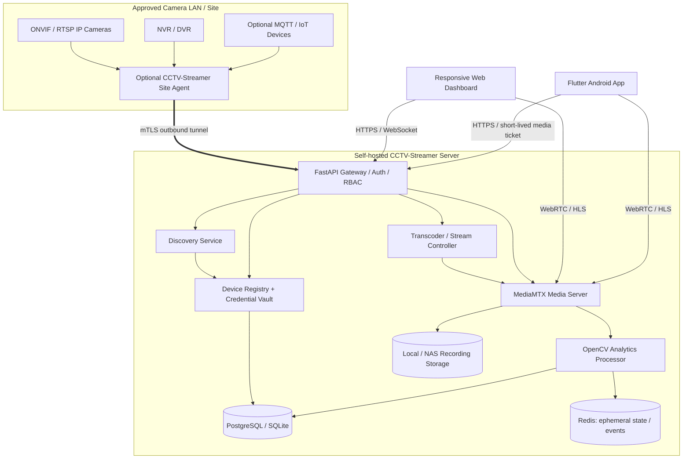

# CCTV-Streamer — Ultra Master Blueprint v1.0

**Repository:** https://github.com/lumifya11/CCTV-Streamer  
**Baseline branch:** `main`  
**Blueprint date:** 22 November 2026  
**Document status:** Final product and engineering specification; implementation remains phase-gated.  
**Primary deployment model:** Self-hosted, local-first, multi-site capable, mobile-compatible CCTV and authorized IoT management platform.

---

## 0. Mission and non-negotiable product definition

Upgrade the existing `CCTV-Streamer` repository into a dependable, self-hosted video surveillance management platform for cameras, NVRs/DVRs, and compatible IoT devices that the operator owns or is expressly authorized to administer.

The finished product must let an operator:

1. Discover compatible devices on explicitly approved local network segments.
2. See each discovered device's IP address, MAC address when available, hostname, vendor/model hints, protocols, ports/services, and last-seen status.
3. Review and approve a device before registering it as a managed camera/device.
4. Add the correct credentials or stream URI for that device, securely store them, and verify access without guessing passwords.
5. See live camera previews, monitor multiple streams, play recordings, review events, and manage compatible camera functions.
6. Use the same account and device inventory from a responsive web dashboard and an Android mobile application.
7. Access remote sites securely through a VPN or authenticated site-agent connection without exposing camera ports directly to the public internet.
8. Run the core platform without paid APIs or mandatory cloud services.
9. Extend compatibility through documented adapters and plugins without rewriting the core.

### Product truth: what “all cameras” can and cannot mean

The platform should maximize practical interoperability, not promise impossible universal access. There is no universal protocol shared by every CCTV product. Compatibility depends on what the camera/NVR exposes: ONVIF, RTSP/RTSPS, HTTP/MJPEG, vendor SDK/API, or a documented integration interface.

Use four explicit compatibility tiers:

- **Tier 1 — Standards-based:** ONVIF device discovery and supported profiles, with RTSP/RTSPS media.
- **Tier 2 — Direct stream:** user-supplied, authenticated RTSP/RTSPS, HTTP/MJPEG, or supported HLS stream.
- **Tier 3 — Vendor adapter:** manufacturer-specific API/SDK integration, only where documentation and lawful credentials are available.
- **Tier 4 — Unsupported:** proprietary or encrypted interfaces without an available supported interface. Explain the limitation; do not claim compatibility.

A device being visible on a network does not prove that it is a camera, that its stream is reachable, that the user owns it, or that the user is authorized to view it.

### Explicit safety and authorization boundary

- Discovery is limited to network scopes added and approved by the system owner.
- The product must not scan arbitrary public IP ranges, nearby third-party networks, or the public internet for cameras.
- It must not bypass authentication, exploit weaknesses, brute-force passwords, try lists of default credentials, or enter cameras without permission.
- Discovery must be non-authenticating by default. Credentials are supplied by the operator during an explicit enrollment step for a camera they are authorized to manage.
- An open RTSP port or ONVIF response is a discovery clue, not an authorization grant.
- A device cannot be streamed until it is approved, has an authorized credential profile or intentionally public/local stream configuration, and passes a connection test.

### “Free / no API” requirement

Core operation must not require a paid cloud account, commercial video API, cloud analytics API, or vendor subscription. Use open standards and self-hosted components wherever practical.

“Free” does not mean “zero requirements”: cameras, compatible firmware, network access, a computer/server, disk capacity, electricity, and sometimes VPN-capable router/network access are still required. Remote viewing also requires a working network path. Optional external push-notification delivery, TURN relays, DNS, or vendor-specific SDKs may introduce separate requirements; they must never be mandatory for core local operation.

---

## 1. Repository audit: current baseline to preserve

The public repository was reviewed on 22 November 2026. It currently has:

- Python 3.11+ project metadata in `pyproject.toml`.
- FastAPI, Uvicorn, Pydantic, OpenCV Headless, NumPy, and HTTPX in the base dependency set.
- Four existing services: `discovery`, `transcoder`, `processor`, and `gateway`.
- A `shared/` package containing configuration, models, logging, and security helpers.
- A small static web console under `services/gateway/static/`.
- Redis in `docker-compose.yml` for runtime state/telemetry.
- Four existing test modules covering discovery, gateway integration, processor/security, and transcoding.
- Dockerfiles per current service, `.env.example`, GitHub Actions CI, MIT license, and README documentation.

### Existing capability map

| Existing path | Current responsibility | Direction |
|---|---|---|
| `services/discovery/app.py` | Discovery API, registry, subnet scan orchestration | Preserve API shape where practical; add site/scope authorization and durable registry integration |
| `services/discovery/onvif_scanner.py` | ONVIF WS-Discovery and SOAP Media stream URI resolution | Preserve standards-based discovery; separate unauthenticated discovery from credentialed enrollment |
| `services/discovery/port_scanner.py` | TCP port probing and RTSP endpoint candidates | Restrict to owner-approved scopes; make rate-limited diagnostics; remove credential attempts during broad discovery |
| `services/transcoder/stream_engine.py` | OpenCV RTSP ingestion, reconnect, frame encoding, synthetic demo streams | Preserve for fallback/demo/analytics; stop treating per-frame MJPEG re-encoding as the only production media delivery path |
| `services/transcoder/app.py` | Stream lifecycle API, snapshots, MJPEG, WebSocket | Keep as stream-control/compatibility API; protect every media route and integrate primary media server |
| `services/processor/analytics_engine.py` | OpenCV motion and tamper analysis | Preserve; add zones, event persistence, configurable sampling, optional plugin analytics |
| `services/processor/app.py` | Frame processing and event/metrics endpoints | Preserve; harden input limits and persist events outside process memory |
| `services/gateway/app.py` | API aggregation and static web console | Keep as the only public application ingress by default; add proper user/session auth and mobile APIs |
| `shared/config.py` | Environment-backed config | Keep centralized; validate production config strictly and fail closed |
| `shared/models.py` | Pydantic domain models | Evolve into versioned API/domain schemas without breaking older clients unnecessarily |
| `shared/security.py` | API key, CIDR, URL and credential helpers | Refactor into explicit auth, network scope, SSRF, secret handling, and redaction layers |
| `docker-compose.yml` | Redis and four current services | Keep as deployment foundation; expose only the gateway by default and add media server/database profiles |
| `services/gateway/static/` | Existing browser console | Keep during migration; replace/upgrade incrementally with a modern web frontend |

### Audit findings that must be fixed before external/remote use

These are observed in the current source, not hypothetical design suggestions:

1. `shared/security.py::verify_api_key` currently allows requests when `API_SECRET_KEY` is absent or begins with `change-me`. Production must fail closed instead.
2. Snapshot, MJPEG, and WebSocket stream routes in the transcoder are not consistently guarded by the API-key dependency. Gateway media proxy routes also need the same authenticated authorization path. Live video is sensitive data and must never be an anonymous endpoint by accident.
3. Discovery currently passes configured/default RTSP credentials into subnet-wide RTSP endpoint probes. Discovery should not attempt credentials on every responding host. Credentials must only be used after a user explicitly selects and approves a device.
4. ONVIF discovery currently attempts SOAP media enrichment with configured credentials as part of the discovery flow. Split this into non-authenticated discovery and an explicit credentialed enrollment/connection test.
5. `ENABLE_DEMO_STREAMS` currently defaults to true in configuration. Demo cameras and synthetic feeds must be opt-in in development and forcibly disabled in production unless a deliberate demo deployment profile is enabled.
6. Docker Compose currently publishes the discovery, transcoder, processor, and gateway ports to the host. Only the gateway should be host-exposed in the secure default profile. Internal services and Redis should remain on private Docker networks.
7. The current registry is primarily process memory. Camera identity, approvals, credentials references, events, and recordings metadata need durable storage.
8. The current processor event deque is in-memory. Events must survive restarts and be indexed/queryable.
9. Stream-source validation checks URI schemes and host presence but is not a complete egress/SSRF policy. Validate destination IPs, redirects, DNS results, and allowed network scope before a worker connects.
10. ONVIF `XAddr` values are received from network devices and then used for SOAP requests. Treat them as untrusted input and validate that the target resolves to the same approved device or its explicitly permitted address before fetching it. Disable redirects and cap response sizes/timeouts.
11. Camera IDs derived only from IP addresses are not stable when DHCP changes an address. Use immutable internal UUIDs and a best-effort device fingerprint; treat IP/MAC/hostname as mutable attributes.
12. The existing bridge-network Docker setup must be tested against actual ONVIF multicast behavior on each supported host OS. ONVIF discovery may need a dedicated local discovery agent or an explicitly documented host-network deployment mode on Linux. Do not switch every container to host networking as a shortcut.

**Baseline rule:** run current tests first, record results, and preserve working behavior unless a security or correctness defect requires a documented change.

---

## 2. Target architecture: control plane, media plane, analytics plane, site plane

Separate responsibilities so that camera management, live video, analytics, and remote sites can scale independently.



### Architecture decisions

**A. Keep the current four services.** Do not rewrite the platform as a new unrelated product. Continue using discovery, transcoder, processor, and gateway. Add registry, credential vault, recording coordination, notifications, and site-agent capabilities as clearly separated packages/services. Avoid deploying a separate container for every small module until load or isolation requirements justify it.

**B. Add MediaMTX as the primary media plane.** Use it as the stream router/proxy and delivery layer. It supports RTSP, WebRTC, HLS, stream proxying, recording/playback, metrics, and built-in/internal or external authentication options. It avoids forcing every camera frame through an OpenCV-to-MJPEG re-encode path. The existing OpenCV engine remains available for test/demo sources, snapshots, compatibility, and analytics sampling.

**C. Keep OpenCV for analytics, not as the universal media server.** Use the source camera stream or a MediaMTX restream; sample frames at a configurable rate and reduced analysis resolution. Do not decode every camera at full resolution for every client preview if a pass-through stream is sufficient.

**D. Database is the source of truth.** PostgreSQL is recommended for production/multi-user installations; SQLite is suitable for single-server development and small personal deployments. Redis is for ephemeral runtime state, locks, pub/sub, queues, and telemetry—not the only copy of important events or camera configuration.

**E. Multi-site support uses site agents.** A site agent runs inside each authorized LAN/VLAN and performs local discovery/stream ingestion. It establishes an outbound mutually authenticated encrypted connection to the central server. This avoids pretending that one server can discover devices through unrelated routers, NAT, VLANs, or physical distance.

---

## 3. Camera/network discovery engine

### 3.1 Discovery inputs and scope policy

Every discovery job must reference a saved `site_id` and one or more approved `network_scope_id` values. Each scope records:

- CIDR/subnet or explicitly listed IPs;
- site and VLAN/network label;
- owner/administrator who approved it;
- allowed discovery methods and ports;
- maximum hosts, concurrency, rate, timeout, and scan window;
- approval timestamp and optional expiry;
- excluded IPs/ranges;
- whether ONVIF multicast is available at that site.

Default to private/local ranges explicitly selected by the owner. Reject arbitrary public internet ranges by default. Add explicit confirmation for unusually large scopes. Keep safe caps and a per-site rate limiter. A manual IP probe is permitted only for a device the user is authorized to administer.

### 3.2 Discovery methods

Implement pluggable, low-impact discovery adapters:

1. **ONVIF WS-Discovery:** detect compatible NetworkVideoTransmitter devices and parse endpoint references/scopes safely.
2. **RTSP service identification:** check only approved target hosts/ports; use protocol-level OPTIONS/response identification without supplying credentials.
3. **mDNS:** discover compatible advertised services on the local link.
4. **SSDP/UPnP:** discover devices that advertise relevant service descriptions; do not equate all UPnP devices with cameras.
5. **ARP/DHCP inventory:** enrich local IP/MAC/hostname information from the local network/router integration where the operator has access.
6. **Manual enrollment:** add a known camera/NVR by address, host name, or stream URI.
7. **Site-agent inventory:** receive approved discoveries from other authorized network segments.

### 3.3 Discovery lifecycle and confidence

Never set a camera to “verified” merely because a port was open. Use explicit states:

- `DISCOVERED_HOST`
- `SERVICE_DETECTED`
- `CAMERA_CANDIDATE`
- `USER_APPROVED`
- `CREDENTIALS_CONFIGURED`
- `CONNECTION_VERIFIED`
- `STREAM_VERIFIED`
- `ONLINE`
- `DEGRADED`
- `OFFLINE`
- `REJECTED`

Store evidence, method, response status, confidence, and timestamps. A port such as 554 may indicate RTSP but not prove that a valid camera stream exists. An ONVIF response provides stronger device evidence but does not prove authorization.

### 3.4 No credential guessing during discovery

Discovery performs no default-password login, dictionary attempts, password spraying, or authentication bypass. Do not automatically inject a global `admin` username/password into all discovered devices. Once the operator approves a specific device, they may enter credentials or select a previously saved credential profile for that device. Only then may the system query ONVIF media profiles or validate a stream.

### 3.5 ONVIF compatibility strategy

Implement Profile T as the primary modern video profile. Retain Profile S as a legacy compatibility adapter for older equipment. ONVIF announced that Profile S support ends on 31 March 2027 and recommends Profile T as its replacement; existing Profile S devices can still be used, but should be clearly marked legacy. Add optional feature detection for:

- **Profile G:** edge recording and retrieval, where camera/NVR supports it;
- **Profile M:** analytics metadata and events, where supported;
- PTZ, imaging, digital I/O, audio, and relay capabilities only when the device advertises them and supports the relevant interfaces.

Do not show controls that the camera does not support. Maintain an interoperability matrix listing manufacturer, model, firmware, ONVIF profile, tested functions, and test date.

### 3.6 Network range and distance truth

There is no universal physical “maximum distance around the user” for IP discovery. Discovery reaches the permitted network segments that the host or site agent can route to. ARP and multicast discovery are generally local-link mechanisms; routers, VLANs, firewalls, NAT, Wi-Fi isolation, and camera configuration affect visibility. For multiple network segments, deploy an approved site agent or configure a permitted routed discovery scope. Do not scan surrounding buildings or unrelated networks.

---

## 4. Device registry and identity model

Create a durable device registry. Do not use IP address as the permanent primary identity.

### Core entities

- `User`: identity, password hash, status, MFA setting.
- `Role`: owner, administrator, operator, viewer; scoped permissions.
- `Session`: token/session metadata, expiry, device, revocation state.
- `Site`: logical physical/network site.
- `NetworkScope`: approved CIDR/IP range and discovery policy.
- `SiteAgent`: agent identity, version, last heartbeat, site assignment, certificate status.
- `Device`: stable UUID, type, identity hints, vendor/model/firmware, serial/ONVIF UUID where available.
- `DeviceAddress`: current and historical IP, MAC, hostname, interface, last seen.
- `CameraCapability`: ONVIF profiles and supported controls/features.
- `CredentialProfile`: encrypted secret reference, protocol, username, owner, last-verified status; never return secret values through API.
- `CameraStream`: main/substream URI reference, codec, resolution, transport, status, profile.
- `RecordingSegment`: camera, path, start/end time, size, checksum, retention state.
- `AnalyticsEvent`: event type, score, severity, camera, timestamp, snapshot reference, metadata.
- `AuditEvent`: user/service, action, target, timestamp, source, result.
- `Plugin`: identifier, version, permissions, enablement, health.

### Identity policy

Use a generated UUID as the immutable database ID. Use ONVIF endpoint UUID, serial number, MAC address, and vendor/model as optional fingerprint hints. A camera changing IP must update its address record, not create a new camera blindly. Avoid relying on IP alone because DHCP assignments can change.

---

## 5. Credential vault and enrollment flow

### Secure enrollment user journey

1. User runs discovery on an approved site/scope.
2. System lists camera candidates and their evidence.
3. User opens one candidate and confirms that they own/administer it or have permission.
4. User selects a protocol: ONVIF, RTSP/RTSPS, HTTP/MJPEG, NVR adapter, or manual URI.
5. User enters credentials or selects a saved credential profile.
6. System stores the credentials encrypted and tests the connection only against that approved device.
7. If ONVIF works, request device information, supported profiles, media profiles, and stream URI.
8. Show a preview test and ask user to confirm enrollment.
9. Register the camera with capabilities and allowed user roles.

### Secret handling requirements

- Never commit `.env`, passwords, camera URLs containing credentials, JWT secrets, certificates, or backup keys.
- Encrypt device credentials at rest with authenticated encryption; use a master key supplied through Docker secrets or a protected host secret file.
- Keep secret material out of API responses, frontend state where possible, logs, exception strings, metrics labels, and audit payloads.
- Do not store credentials in a plain-text RTSP URL in the public device record. Store a sanitized URI template plus a separate secret reference.
- Use a dedicated secret-access function with least privilege and auditable access.
- Support credential rotation and re-verification.
- If the vault key is lost, explain that encrypted credentials cannot be recovered; provide a documented backup/export procedure for the vault key.

---

## 6. Streaming and playback architecture

### 6.1 Primary media server: MediaMTX

Integrate MediaMTX as a dedicated container/process. The `transcoder` service becomes the stream controller/adapter and keeps responsibility for lifecycle state, camera-to-media-path mapping, health metrics, and compatibility handling.

Use MediaMTX for:

- pulling approved camera RTSP/RTSPS streams;
- restreaming to internal RTSP paths;
- browser/mobile WebRTC delivery for low latency;
- HLS as a compatibility fallback;
- optional RTSP client access on the trusted local network;
- stream recording to local storage;
- playback of recorded segments;
- per-path authentication and metrics.

Keep MediaMTX Control API private to the internal network. The Gateway issues short-lived, narrowly scoped stream tickets or delegates to a MediaMTX authentication callback/JWT configuration. Never expose an open anonymous media path.

### 6.2 Protocol selection

- **Camera ingest:** prefer RTSP/RTSPS offered by the camera; use ONVIF to discover supported media profiles/stream URI where available.
- **Browser/mobile low latency:** prefer WebRTC when supported by client/network.
- **Fallback playback:** HLS for broad browser compatibility, accepting higher latency.
- **Internal tools:** RTSP where suitable.
- **Legacy preview:** retain existing MJPEG endpoint only as a protected compatibility route; do not use it as the default high-camera-count pipeline.

The app should display which transport is active and give a useful explanation if a camera codec or network path is unsupported.

### 6.3 OpenCV and FFmpeg responsibilities

- OpenCV remains for motion/tamper analytics, image processing, snapshots, and synthetic test feeds.
- FFmpeg is used for targeted codec conversion, stream diagnostics, thumbnails, and cases where a camera format needs conversion.
- Prefer stream copy/pass-through when no codec change is required.
- Avoid decoding and re-encoding every full-resolution stream solely to render a dashboard.
- Record which stream profile is used for analytics vs live viewing.

### 6.4 Stream lifecycle states

Use a robust state machine:

`UNCONFIGURED → CONFIGURED → CONNECTING → STREAMING → DEGRADED → RECONNECTING → OFFLINE`

Track: stream ID, camera ID, media path, FPS, bitrate, resolution, codec, transport, first-frame time, last-frame time, ingest latency, reconnect count, last error code, and sanitized error message.

Reconnect with bounded exponential backoff and jitter. Use per-camera limits, cancellation, and global resource budgets. One failed camera must not stall other streams.

### 6.5 Camera control

Where explicitly supported and authorized, add ONVIF PTZ movement, presets, imaging settings, and I/O controls. Each action must be permission-checked, capability-checked, logged, and require confirmation for potentially disruptive actions. Do not invent universal PTZ support.

---

## 7. Recording and storage system

### Recording modes

- continuous;
- scheduled;
- motion/event-triggered;
- manually started/stopped by an authorized operator.

### Recording requirements

- Configure by camera and stream profile.
- Write segment metadata to the database.
- Use MediaMTX recording where supported; use FFmpeg only for special formats/requirements.
- Prefer recoverable segmented recording (for example, fMP4 or MPEG-TS segments).
- Create an index containing start/end timestamps, duration, codec, resolution, file size, checksum, and storage location.
- Handle disk-full conditions gracefully; do not silently stop recording.
- Provide configurable retention by days, storage budget, or camera priority.
- Protect recordings with role-based access and signed download links.
- Record all viewing, export, delete, and retention actions in audit history.
- Support local disk and user-configured mounted NAS/storage paths. Do not silently upload recordings to a third-party service.
- Provide backup/restore for metadata and configuration; document that video backups require sufficient separate storage.

### Storage estimate tool

Add a calculator using measured or configured bitrate, camera count, daily recording hours, and retention days:

`Estimated GB = bitrate_Mbps × 3600 × hours_per_day × days × camera_count ÷ 8 ÷ 1000`

Show an estimate and a warning margin. Actual storage varies with codec, motion, frame rate, VBR/CBR, audio, and camera settings. Do not promise exact storage without measuring the actual stream.

---

## 8. Analytics and event engine

Preserve the existing OpenCV motion/tamper engine and extend it incrementally.

### Core local analytics

- motion detection with per-camera sensitivity;
- user-defined detection zones and masked privacy zones;
- camera obstruction/blackout/tamper detection;
- scene-change detection;
- event cooldown and deduplication;
- snapshots and optional short pre/post event clips;
- event severity and source confidence;
- per-camera analytics enable/disable and frame sampling rate.

### Optional AI analytics

Add a plugin interface for local object detection (person, vehicle, animal, package) only after the base streaming and event system is stable. AI must run locally by default where hardware allows. It is optional and must not block the core application if no GPU/accelerator is available. Do not assume object labels are always correct; expose confidence and allow review.

Optional integration with Frigate may be provided as an adapter for deployments that already run Frigate. It must not be a core dependency or require cloud AI.

### Event persistence

Events must be stored in PostgreSQL/SQLite and include camera/site/time/type/severity/score/zone, snapshot reference, processing version, and acknowledgement state. Redis may broadcast events in real time, but must not be the sole durable event store.

---

## 9. IoT and NVR/DVR integrations

### Integration strategy

Use plugin/adapters with a common interface:

- `discover()` — discover only within approved site/scope;
- `identify()` — return capability and vendor/model data;
- `enroll()` — validate operator-provided credentials;
- `get_status()` — poll status;
- `get_capabilities()` — describe supported functions;
- `execute()` — perform explicitly permitted action;
- `health_check()` — report adapter health.

### Priority adapters

1. ONVIF cameras and compatible NVRs.
2. Generic RTSP/RTSPS cameras.
3. User-configured HTTP/MJPEG camera sources.
4. Vendor adapters only with supported documentation/SDK and clear license review.
5. NVR/DVR channel mapping, using ONVIF or authenticated vendor integration where available.
6. Optional MQTT integration for compatible IoT device telemetry/events.
7. Optional Home Assistant integration for local device inventory/events and approved actions.
8. Optional Zigbee2MQTT/MQTT integrations where the operator already runs those services.

Do not advertise “every device” integration. Publish a compatibility matrix and test exact device models/firmware. IoT control actions require separate permissions from camera viewing.

---

## 10. Web dashboard and Android mobile application

### Web dashboard

Retain the current `services/gateway/static/` UI during the migration. Build a modern frontend under `frontend/web/` using React + TypeScript (or another maintainable frontend chosen after a small proof of concept). The Gateway serves the built assets or a reverse proxy serves them.

Primary pages:

1. Overview: camera counts, online/offline/degraded, recording status, alerts, storage usage, server health.
2. Live Monitor: configurable camera grid, single-camera fullscreen, layouts, stream quality, quick filters.
3. Camera Inventory: discovery candidates, approval, device details, capabilities, credentials status, last seen.
4. Recordings: searchable timeline, date/time filters, playback, export.
5. Events: motion/tamper events, snapshots, acknowledgement, filters.
6. Sites & Networks: sites, approved scopes, site agents, scan jobs.
7. Device/IoT: grouped devices, status and supported actions.
8. Users & Security: users, roles, sessions, audit log, MFA, access policies.
9. System Settings: storage, stream settings, network settings, retention, backup, plugins.

### Android mobile app

Use Flutter with a clear UI/data separation, repositories, service clients, and feature-based modules. The mobile app must not contain a permanent server API secret or camera credentials.

Mobile screens:

- first-run server pairing (QR code or manual local URL);
- login and optional MFA;
- overview;
- camera grid;
- live view/fullscreen;
- camera/device details;
- recordings/playback;
- event inbox;
- site/device status;
- settings, server health, storage summary;
- session/device management.

Mobile behavior:

- Use HTTPS to the Gateway.
- Obtain short-lived, camera-scoped playback tickets from the Gateway.
- Prefer WebRTC; fall back to HLS when necessary.
- Keep camera source credentials on the server, not in the app.
- Support reconnect and background/foreground lifecycle correctly.
- Show a clear offline state when the phone cannot reach the self-hosted server.
- For notifications, support in-app/WebSocket notifications while active and local notifications where feasible. Cloud push providers may be optional; do not claim reliable background push without a delivery service.

### Design language

Use a professional security operations interface, not a cluttered hacker-style console. Provide dark and light themes, readable contrast, accessible labels, clear online/offline states, responsive camera tiles, and an obvious privacy/recording indicator. Avoid exposing full RTSP URIs or secrets in UI.

---

## 11. Remote access and multi-site architecture

### Default: local-first

The initial installation works on the user's local LAN with no cloud account. Only the Gateway is exposed to the trusted LAN by default.

### Remote access recommendation

Prefer a self-hosted WireGuard VPN or an equivalent trusted private network. The phone connects to the VPN, then uses the same private Gateway address it uses at home. This keeps camera RTSP ports off the public internet.

For a site agent, use mutually authenticated TLS with a unique agent identity and revocable certificate/token. Agents initiate outbound connections to the central server. The central service authorizes each site, scope, and device.

### NAT and WebRTC

Remote WebRTC may require a reachable UDP path or a self-hosted TURN relay in some networks. The recommended first option is a VPN. Optional TURN can be added for difficult NAT/firewall situations. Document the extra bandwidth and hosting needs.

Never expose all camera RTSP ports to the public internet. Never provide a “scan the internet for cameras” mode.

---

## 12. Authentication, authorization, and security architecture

Security is a release blocker, not a future enhancement.

### Authentication

- Production starts only when required secrets and an administrator bootstrap flow are configured.
- Fail closed if secrets are missing or equal to placeholders such as `change-me`.
- Use secure password hashing (Argon2id or a well-maintained equivalent), login throttling, session expiration, refresh-token rotation, revocation, and optional TOTP MFA.
- Use short-lived access tokens or secure session cookies; choose based on web/mobile client needs and document CSRF/CORS requirements.
- Use a one-time owner setup flow; do not ship a hard-coded admin/admin account.
- Service-to-service authentication must be separate from user authentication.

### Authorization

Roles:

- `OWNER`: system ownership, initial setup, secret/backup administration;
- `ADMIN`: users, sites, scopes, cameras, system configuration;
- `OPERATOR`: approved camera viewing, playback, event acknowledgement and explicitly permitted controls;
- `VIEWER`: read-only access only to assigned cameras/sites.

Enforce resource-level authorization on every request. A valid login is not enough: the user must have permission for that specific site, camera, recording, event, or action.

### Media security

- Protect snapshot, MJPEG, WebSocket, WebRTC, HLS, recording, and playback paths.
- For browser WebSockets, issue a short-lived, one-time, camera-scoped ticket over authenticated HTTPS; do not rely on a permanent token in a URL query string.
- Verify the ticket on connection and authorize each requested camera/stream.
- Apply MediaMTX internal/HTTP/JWT authentication so the media plane cannot be bypassed through a direct media URL.
- Never expose an anonymous “read all streams” configuration.

### Network/SSRF protections

- Apply a server-side allowlist of approved site CIDRs and approved device IPs/hostnames.
- Resolve hostnames and validate the resulting IP addresses at connection time; mitigate DNS rebinding by pinning the validated address for the connection.
- Reject loopback, link-local, multicast, broadcast, cloud metadata, and out-of-scope destinations unless a tightly defined local exception is explicitly approved for a legitimate integration.
- Validate ONVIF XAddr and stream source before any outbound request.
- Disable HTTP redirects for device probes or revalidate every redirect target.
- Bound response sizes, timeouts, concurrency, and frame upload sizes.
- Do not allow the API to fetch arbitrary URLs submitted by clients.

### Logging and audit

- Redact credentials, authorization headers, signed tickets, and tokens.
- Audit login failures, discovery jobs, device approval/rejection, credential access/rotation, stream access, PTZ actions, recording playback/export/deletion, user changes, and plugin install/enable/disable.
- Do not record video frames or plaintext passwords in logs.

### Containers and network

- Only Gateway/reverse proxy is host-published by default.
- Redis, database, processor, discovery, transcoder control API, and MediaMTX control API stay on internal networks.
- Expose only required MediaMTX listener ports to the trusted LAN/VPN.
- Use non-root containers, read-only filesystem where feasible, dropped Linux capabilities, `no-new-privileges`, resource limits, health checks, and log rotation.
- Store secrets through Docker secrets or protected host files, not committed `.env` files.
- Use separate profiles for discovery network access and optional hardware acceleration.

---

## 13. API contract (versioned)

All public application APIs live under `/api/v1/`. Internal service APIs are private and authenticated separately.

### Authentication and pairing

- `POST /api/v1/auth/bootstrap` — one-time first-owner setup, only when no owner exists.
- `POST /api/v1/auth/login`
- `POST /api/v1/auth/refresh`
- `POST /api/v1/auth/logout`
- `GET /api/v1/auth/me`
- `POST /api/v1/mobile/pairing/start`
- `POST /api/v1/mobile/pairing/complete`
- `POST /api/v1/mobile/stream-ticket`

### Sites and discovery

- `GET /api/v1/sites`
- `POST /api/v1/sites`
- `GET /api/v1/sites/{site_id}/scopes`
- `POST /api/v1/sites/{site_id}/scopes`
- `POST /api/v1/discovery/jobs`
- `GET /api/v1/discovery/jobs/{job_id}`
- `GET /api/v1/discovery/candidates`
- `POST /api/v1/discovery/candidates/{candidate_id}/approve`
- `POST /api/v1/discovery/candidates/{candidate_id}/reject`

### Devices and cameras

- `GET /api/v1/devices`
- `GET /api/v1/devices/{device_id}`
- `PATCH /api/v1/devices/{device_id}`
- `DELETE /api/v1/devices/{device_id}`
- `POST /api/v1/devices/{device_id}/enroll`
- `POST /api/v1/devices/{device_id}/test-connection`
- `GET /api/v1/cameras`
- `GET /api/v1/cameras/{camera_id}/capabilities`
- `GET /api/v1/cameras/{camera_id}/streams`
- `POST /api/v1/cameras/{camera_id}/streams`

### Live streams and recordings

- `GET /api/v1/streams`
- `GET /api/v1/streams/{stream_id}/status`
- `POST /api/v1/streams/{stream_id}/reconnect`
- `POST /api/v1/streams/{stream_id}/playback-ticket`
- `GET /api/v1/recordings`
- `GET /api/v1/recordings/{recording_id}`
- `POST /api/v1/recordings/{recording_id}/export` (permission checked and audited)
- `DELETE /api/v1/recordings/{recording_id}` (owner/admin only; audited)

### Events, system, audit, and plugins

- `GET /api/v1/events`
- `POST /api/v1/events/{event_id}/acknowledge`
- `GET /api/v1/system/health`
- `GET /api/v1/system/storage`
- `GET /api/v1/audit`
- `GET /api/v1/plugins`
- `POST /api/v1/plugins/{plugin_id}/enable`
- `POST /api/v1/plugins/{plugin_id}/disable`

API schemas must be versioned and validated with Pydantic. Return consistent error codes and correlation IDs. Never return credential values or internal service secrets.

---

## 14. Recommended implementation stack

| Area | Primary choice | Reason / notes |
|---|---|---|
| Backend/API | Existing FastAPI + Python 3.11+ | Preserve current codebase and API ecosystem |
| Schema validation | Pydantic 2 | Already present |
| Database | PostgreSQL production; SQLite development/small single-node | Durable inventory/events and simpler development |
| ORM/migrations | SQLAlchemy 2 + Alembic (or equivalent reviewed stack) | Durable schema evolution |
| Runtime state | Existing Redis | Locks, pub/sub, transient health and jobs; not source of truth |
| Primary media plane | MediaMTX | RTSP, WebRTC, HLS, recording, playback, auth, metrics |
| Stream conversion/diagnostics | FFmpeg | Use when needed; prefer pass-through |
| Analytics | Existing OpenCV | Local motion/tamper and frame processing |
| Optional advanced NVR/AI | Frigate adapter | Optional integration only, not required core |
| Mobile | Flutter | Android-first cross-platform option with layered app architecture |
| Web frontend | React + TypeScript, incremental migration | Modern responsive web UI; keep current static UI during transition |
| Remote private network | WireGuard | Self-hosted VPN option; no vendor cloud required |
| Optional IoT events | MQTT/Mosquitto adapter | Local telemetry and integration path |
| Deployment | Docker Compose | Already used by repository; simple self-hosted deployment |
| CI | Existing GitHub Actions + pytest | Extend with lint/type/security/build/test gates |

Do not add a new technology just because it is fashionable. Every dependency must have a concrete responsibility, active maintenance check, license review, vulnerability review, and resource impact note. Pin tested versions in lockfiles/images and update them deliberately.

---

## 15. Repository target structure (incremental, compatible with existing paths)

Do not rename the current service folders. Extend them in place.

```text
CCTV-Streamer/
├── services/
│   ├── discovery/
│   │   ├── app.py
│   │   ├── onvif_scanner.py                 # existing; refactor discovery/enrollment boundary
│   │   ├── port_scanner.py                  # existing; safe scoped diagnostics only
│   │   ├── adapters/
│   │   │   ├── onvif.py
│   │   │   ├── rtsp_probe.py
│   │   │   ├── mdns.py
│   │   │   ├── ssdp.py
│   │   │   ├── arp_inventory.py
│   │   │   └── dhcp_inventory.py
│   │   ├── scope_policy.py
│   │   ├── candidate_service.py
│   │   └── tests/
│   ├── transcoder/
│   │   ├── app.py
│   │   ├── stream_engine.py                 # existing OpenCV engine retained
│   │   ├── stream_manager.py
│   │   ├── mediamtx_client.py               # new control adapter
│   │   ├── stream_state.py
│   │   ├── reconnect_manager.py
│   │   └── tests/
│   ├── processor/
│   │   ├── app.py
│   │   ├── analytics_engine.py              # existing engine retained
│   │   ├── zones.py
│   │   ├── event_persistence.py
│   │   ├── frame_sampler.py
│   │   ├── plugins/
│   │   └── tests/
│   ├── gateway/
│   │   ├── app.py
│   │   ├── routes/
│   │   │   ├── auth.py
│   │   │   ├── sites.py
│   │   │   ├── discovery.py
│   │   │   ├── devices.py
│   │   │   ├── cameras.py
│   │   │   ├── streams.py
│   │   │   ├── recordings.py
│   │   │   ├── events.py
│   │   │   ├── mobile.py
│   │   │   ├── audit.py
│   │   │   └── system.py
│   │   ├── websocket/
│   │   ├── middleware/
│   │   └── static/                          # current UI remains during transition
│   ├── device_manager/
│   │   ├── registry.py
│   │   ├── identity.py
│   │   ├── capabilities.py
│   │   └── enrollment.py
│   ├── recording/
│   │   ├── coordinator.py
│   │   ├── indexer.py
│   │   ├── retention.py
│   │   └── storage.py
│   ├── site_agent/
│   │   ├── app.py
│   │   ├── identity.py
│   │   ├── tunnel.py
│   │   └── local_discovery.py
│   ├── notifications/
│   │   ├── dispatcher.py
│   │   └── channels.py
│   └── integrations/
│       ├── onvif/
│       ├── rtsp/
│       ├── nvr/
│       ├── mqtt/
│       ├── home_assistant/
│       └── plugin_manager.py
├── shared/
│   ├── config.py                            # existing; strict validation
│   ├── models.py                            # existing; evolve carefully
│   ├── logger.py                            # existing; stronger redaction
│   ├── security.py                          # existing; fail-closed refactor
│   ├── database.py
│   ├── auth.py
│   ├── secrets.py
│   ├── audit.py
│   ├── schemas/
│   └── utilities/
├── frontend/
│   └── web/                                 # React + TypeScript app
├── mobile/
│   └── flutter_app/                         # Android-first Flutter client
├── media/
│   └── mediamtx/
│       ├── mediamtx.yml
│       └── README.md
├── database/
│   └── migrations/
├── deployment/
│   ├── docker/
│   ├── reverse_proxy/
│   ├── wireguard/                           # optional examples, secrets excluded
│   ├── site_agent/
│   └── profiles/
├── docs/
│   ├── architecture/
│   │   └── ULTRA_MASTER_BLUEPRINT.md
│   ├── security/
│   ├── installation/
│   ├── compatibility/
│   ├── mobile/
│   ├── operations/
│   └── api/
├── tests/
│   ├── discovery/
│   ├── registry/
│   ├── auth/
│   ├── transcoder/
│   ├── media_security/
│   ├── processor/
│   ├── gateway/
│   ├── mobile_api/
│   ├── site_agent/
│   └── integration/
├── .github/
│   └── workflows/
├── .env.example
├── .gitignore
├── docker-compose.yml
├── pyproject.toml
├── requirements.txt
├── README.md
├── CONTRIBUTING.md
├── SECURITY.md
└── LICENSE
```

The tree describes the target state, not a demand to create every folder in one commit. Create a module when its first tested implementation is ready. Avoid empty placeholder directories that imply a feature exists when it does not.

---

## 16. Deployment profiles and operating modes

### Profile A — Developer/demo

- Synthetic demo feeds explicitly enabled.
- Local test fixtures and simulated camera inventory.
- No real camera credentials required.
- Not intended to be exposed to a LAN or internet without authentication.

### Profile B — Personal LAN deployment

- Production authentication required.
- Only Gateway exposed to the LAN.
- Discovery runs against explicitly configured local scopes.
- Database and Redis private.
- Media server listeners restricted to trusted LAN interfaces.
- Recordings stored on configured local disk.

### Profile C — Remote/mobile deployment

- Profile B plus WireGuard/private network or a secure HTTPS reverse proxy.
- MFA recommended.
- Short-lived media tickets.
- No camera RTSP port forwarded directly to the public internet.

### Profile D — Multi-site deployment

- Central server plus one site agent per approved LAN/VLAN/site.
- Agent identity/certificate and site authorization.
- Outbound mutually authenticated connection.
- Per-site scopes, camera permissions, metrics, and audit.

### Profile E — Hardware-accelerated deployment

- Optional GPU/device mapping for video decode/AI analytics.
- Validate driver and codec compatibility on the user's OS/hardware.
- CPU fallback remains functional for reduced workloads.

### Docker networking note

Keep the default Compose bridge network for service-to-service isolation. ONVIF multicast discovery must be validated on the actual host platform. If multicast cannot reach the camera LAN through a bridge, run only the discovery agent/service with the required host-network access on supported Linux systems, or use a host-installed site agent. Do not expose every service or place every container on the host network. Docker documents host networking as sharing the host network stack and recommends it only when a system-level tool genuinely needs that access.

---

## 17. Performance, reliability, and observability

### No fixed camera-count promise

Capacity depends on camera count, resolution, codec, frame rate, bitrate, whether streams are passed through or transcoded, number of viewers, analytics sampling, storage type, CPU/GPU, and network bandwidth. The application must measure and report actual behavior instead of promising “unlimited cameras.”

### Required metrics

- discovery duration, hosts checked, candidates found, errors, and scan rate;
- per-device last-seen and connection-test result;
- per-stream FPS, bitrate, resolution, codec, latency, dropped frames, reconnects;
- per-camera analytics sample rate and processing time;
- recording write rate, disk utilization, segment count, retention backlog;
- API latency and error rates;
- active users, sessions, media viewers, and denied authorization attempts;
- per-container CPU/RAM and health.

### Reliability requirements

- A camera disconnect must not crash the service.
- A failed site agent must not make other sites unavailable.
- Discovery jobs are cancellable and bounded.
- Long-running recording and streaming work must not block API event loops.
- Graceful shutdown closes streams and recording segments safely.
- Database migrations are versioned and backed up.
- Redis restart must not delete the device registry or durable events.
- Use correlation IDs across Gateway and internal services.

---

## 18. Testing strategy and release gates

### Automated tests

1. Unit tests for CIDR scope policy, URL validation, device identity, state transitions, secret redaction, capability mapping, and retention rules.
2. ONVIF fixture tests for valid, malformed, oversized, malicious, and unexpected SOAP/XML responses.
3. RTSP protocol tests using a local mock server; never test against random public cameras.
4. Stream lifecycle tests: connect, first frame, disconnect, reconnect, invalid URI, bad credentials, timeout, shutdown.
5. Authentication tests: missing secret, placeholder secret, expired token, revoked session, MFA, brute-force throttling.
6. Authorization tests: cross-user camera access, cross-site access, unauthorized playback/export/PTZ, direct media endpoint access.
7. SSRF tests: loopback, link-local, metadata IP, public IP, DNS rebinding, redirect to forbidden destination, IPv6 edge cases.
8. Database tests: persistence across restart, migration upgrade, backup/restore, retention cleanup.
9. Mobile API contract tests and pairing/session tests.
10. Docker Compose smoke tests, health checks, and CI image build.

### Manual acceptance test matrix

Use a controlled lab with:

- one ONVIF Profile T camera;
- one legacy ONVIF Profile S camera if available;
- one generic RTSP camera/stream;
- one NVR/DVR channel if available;
- one intentionally invalid-credential test device;
- synthetic demo streams for CI/development only.

### Definition of Done

A milestone is not complete until:

- feature code exists in the repository;
- automated tests pass;
- security and authorization tests pass;
- API docs and user docs are updated;
- a clean Docker install has been tested;
- errors and unsupported-device conditions are documented;
- no secrets are committed;
- a reviewer can reproduce the result from the README.

### Release blockers

- Any unauthenticated live-video, snapshot, WebSocket, HLS, WebRTC, or recording endpoint.
- Any production fail-open authentication behavior.
- Any automatic default-password guessing or broad credential use during discovery.
- Any unbounded network scan or unrestricted URL fetch.
- Any exposed internal service port in the secure default profile.
- Any secret or camera credential committed to Git.
- Any false claim that every CCTV brand/model can be accessed.

---

## 19. Implementation roadmap and commit sequence

Work in small, reviewable, testable commits. Keep `main` stable; develop through feature branches and pull requests.

### Phase 0 — Baseline and safety hardening

- Run existing tests and record baseline.
- Add production config validation and fail-closed authentication.
- Protect all media routes and WebSockets.
- Stop default-credential use in broad discovery.
- Separate ONVIF discovery from authenticated enrollment.
- Make demo mode explicitly opt-in and disabled in production.
- Restrict Docker published ports to Gateway by default.
- Harden stream URL/XAddr destination validation and DNS/redirect policy.
- Add regression tests for every fix.

**Exit gate:** current project still starts; no unauthenticated media access; discovery does not send camera credentials; production cannot start with placeholder secrets.

### Phase 1 — Database and Device Registry

- Add DB abstraction and migrations.
- Implement persistent sites, scopes, device candidates, devices, capabilities, and audit models.
- Replace IP-only identity with stable UUID and address history.
- Add candidate approval/rejection workflow.

**Exit gate:** discovered devices persist across restart; unapproved candidates cannot stream.

### Phase 2 — Discovery v2

- Add approved scope management and scan jobs.
- Separate discovery from connection validation.
- Add mDNS/SSDP/ARP/DHCP adapters incrementally.
- Add site-agent discovery boundary.
- Publish tested scope and platform limitations.

**Exit gate:** all scans are scope-bound, rate-limited, cancellable, and auditable.

### Phase 3 — Credential vault and camera enrollment

- Add encrypted credential profiles.
- Implement explicit ONVIF enrollment and RTSP test flow.
- Query profiles/capabilities only after approval.
- Add credential rotation and secret redaction.

**Exit gate:** authorized camera can be added and verified; wrong credentials do not leak or trigger repeated guesses.

### Phase 4 — MediaMTX integration

- Add MediaMTX container/config and internal control adapter.
- Implement secure camera-to-path mapping.
- Add authenticated WebRTC and HLS delivery.
- Keep OpenCV fallback and frame sampling for analytics.
- Secure snapshots, MJPEG, and WebSocket compatibility routes.

**Exit gate:** browser and Android test client can view an approved camera; unauthorized users cannot access its media path.

### Phase 5 — Durable events and recording

- Add event persistence and searchable history.
- Add recording coordinator/indexer/retention.
- Add playback/export permissions.
- Add storage estimate and disk-full handling.

**Exit gate:** recording survives server restart, playback works, retention is enforceable, and every export is audited.

### Phase 6 — Web dashboard

- Migrate UI incrementally from current static frontend.
- Build camera grid, inventory, sites, events, recordings, and user/security settings.
- Keep API schemas stable and documented.

**Exit gate:** full personal-LAN use is possible from the web dashboard without direct camera URLs or secrets.

### Phase 7 — Flutter Android application

- Server pairing, authentication, camera grid, live view, events, playback, settings.
- WebRTC/HLS fallback, short-lived media tickets, session revocation.
- Android lifecycle, offline UX, and secure local storage.

**Exit gate:** Android app can pair with a self-hosted server and perform the same authorized viewing workflow securely.

### Phase 8 — Remote access and site agents

- WireGuard deployment guide and optional self-hosted setup.
- Site-agent identity and mTLS outbound channel.
- Multi-site inventory and event routing.
- Revoke compromised agents.

**Exit gate:** a second authorized LAN can report devices through an agent without public camera-port exposure.

### Phase 9 — Compatibility and optional plugins

- ONVIF Profile T, legacy S, G, M capabilities as available.
- Vendor/NVR adapters one at a time with hardware testing.
- MQTT/Home Assistant/Frigate optional adapters.
- Local AI plugin only after resource and accuracy evaluation.

**Exit gate:** publish a tested compatibility matrix, license inventory, plugin permission model, and upgrade policy.

### Phase 10 — Production release

- Threat model, security review, performance benchmark, backup/restore test.
- Documentation, installation wizard, migration guide, support matrix.
- Signed release artifacts and reproducible build notes where feasible.

**Exit gate:** every item in the release checklist passes; no unimplemented features are represented as available.

---

## 20. GitHub engineering rules

- Keep `main` as the stable branch.
- Use feature branches such as `security/fail-closed-media-auth`, `feature/device-registry`, `feature/mediamtx-integration`, and `feature/flutter-mobile`.
- Each PR should have one clear purpose, linked issue, tests, migration notes, screenshots where relevant, and security impact summary.
- Do not commit `.env`, secrets, sample camera credentials, real surveillance footage, private IP inventories, or personal data.
- Keep `.env.example` limited to safe placeholders and explain which variables are mandatory in production.
- Use dependency pinning/lockfiles, automated tests, linting, formatting, typing, dependency scanning, secret scanning, and container image scanning.
- Maintain `SECURITY.md`, `CONTRIBUTING.md`, license notices, and a device compatibility matrix.
- Make database schema changes with migrations and a rollback/backup plan.
- Do not mark a phase complete based on a README claim; require code, tests, and a reproducible acceptance result.

### Suggested initial issues

1. `SEC-001` Fail-closed production authentication.
2. `SEC-002` Protect snapshot/MJPEG/WebSocket media endpoints.
3. `DISC-001` Remove credentials from broad RTSP scan path.
4. `DISC-002` Split ONVIF discovery from credentialed enrollment.
5. `SEC-003` Add destination allowlist and SSRF protection for camera source/XAddr.
6. `DEP-001` Expose only Gateway by default in Compose.
7. `DEV-001` Disable demo streams in production and add explicit demo profile.
8. `DATA-001` Add persistent Device Registry and migrations.
9. `MEDIA-001` Integrate MediaMTX as media plane.
10. `MOBILE-001` Create Flutter app and secure pairing contract.

---

## 21. Final product acceptance checklist

The platform is ready for its first stable release only when all relevant items below are demonstrated:

- [ ] Existing CCTV-Streamer functionality is preserved or migrated with tests.
- [ ] Owner can configure a site and approve an authorized network scope.
- [ ] Discovery identifies candidates without attempting credentials.
- [ ] Device candidate requires approval before enrollment.
- [ ] Camera credentials are encrypted at rest and never returned through public APIs.
- [ ] ONVIF Profile T and generic RTSP workflows are tested.
- [ ] Legacy Profile S support is documented as legacy.
- [ ] Unsupported cameras are reported honestly with an adapter path if one exists.
- [ ] Camera inventory and IP history persist after restart.
- [ ] Live viewing is protected for every protocol and route.
- [ ] Browser and Android clients use short-lived, camera-scoped stream authorization.
- [ ] Recording, playback, retention, export, and deletion permissions are tested.
- [ ] Motion/tamper events persist and can be reviewed.
- [ ] Only Gateway is publicly/host exposed in secure default Compose profile.
- [ ] Remote access is VPN/site-agent based and does not expose camera ports directly.
- [ ] Multi-site discovery works only through explicitly authorized site agents/scopes.
- [ ] Backup and restore have been tested.
- [ ] Security, load, and regression test suites pass.
- [ ] Documentation and compatibility matrix match the actual shipped implementation.

---

## 22. Source-of-truth technical references

Use official documentation as the authority when implementing and updating integrations. Re-check these sources before pinning versions or relying on a changing feature.

1. **ONVIF Profiles:** https://www.onvif.org/profiles/  
   Profiles relevant to video include T (advanced streaming), G (edge storage/retrieval), M (metadata/events), and S (basic streaming, in deprecation process).
2. **ONVIF Profile T:** https://www.onvif.org/profiles/profile-t/  
   Advanced video streaming, H.264/H.265, motion/tampering events, imaging, metadata, and supported device/client controls.
3. **ONVIF Profile S deprecation notice:** https://www.onvif.org/pressrelease/onvif-to-end-support-for-profile-s/  
   ONVIF announced the transition from Profile S to Profile T.
4. **ONVIF Profile S deprecation Q&A:** https://www.onvif.org/profiles/profile-s/profile-s-deprecation-qna/  
   Support/submission timing and legacy-device guidance; support for Profile S ends on 31 March 2027.
5. **ONVIF Profile G:** https://www.onvif.org/profiles/profile-g/  
   Edge recording and retrieval where supported.
6. **ONVIF Profile M:** https://www.onvif.org/profiles/profile-m/  
   Metadata and analytics event interfaces.
7. **MediaMTX introduction:** https://mediamtx.org/docs/kickoff/introduction  
   Media routing, RTSP/WebRTC/HLS, recording/playback, authentication, control API, and metrics.
8. **MediaMTX authentication:** https://mediamtx.org/docs/features/authentication  
   Internal, HTTP, and JWT authentication models.
9. **MediaMTX recording:** https://mediamtx.org/docs/features/record  
   Recording formats and storage configuration.
10. **MediaMTX playback:** https://mediamtx.org/docs/features/playback  
    Recording playback API.
11. **Docker Compose networking:** https://docs.docker.com/compose/how-tos/networking/  
    Bridge networking and host-network tradeoffs.
12. **Flutter app architecture:** https://docs.flutter.dev/app-architecture/guide  
    Layered, maintainable app architecture.
13. **OWASP API Security Top 10:** https://api-security.owasp.org/  
    Broken authentication/authorization, unrestricted resource consumption, SSRF, security misconfiguration, and inventory risks.
14. **Frigate documentation (optional integration):** https://docs.frigate.video/  
    Local NVR/object detection and MQTT integration concepts; not a mandatory dependency.
15. **go2rtc documentation (optional alternative):** https://go2rtc.org/  
    Alternative stream proxy/WebRTC integration; do not add both go2rtc and MediaMTX as mandatory core components.

---

# MASTER IMPLEMENTATION INSTRUCTION

Treat this document as the product source of truth for CCTV-Streamer v1.x. Do not start by generating a brand-new repository or replacing the existing code. Inspect the current implementation, run the tests, create a baseline, and implement the roadmap in small phases. Preserve existing paths and working functions unless a documented security/correctness fix requires a change.

At every phase, report:

1. files inspected;
2. files created/modified;
3. exact behavior implemented;
4. tests added and results;
5. security implications;
6. commands to run locally and with Docker Compose;
7. known limitations and next acceptance gate.

Never claim that all camera brands, all networks, all devices, or unlimited camera counts are supported without test evidence. Do not implement unauthorized discovery, authentication bypass, credential guessing, or access to devices outside the operator-approved network scopes.

**Final outcome:** a secure, local-first, self-hosted, multi-site capable CCTV and compatible IoT management platform with a shared device registry, robust discovery, reliable streaming, recording, analytics, web dashboard, Android mobile app, and documented plugin ecosystem—built by evolving the existing `lumifya11/CCTV-Streamer` repository.
